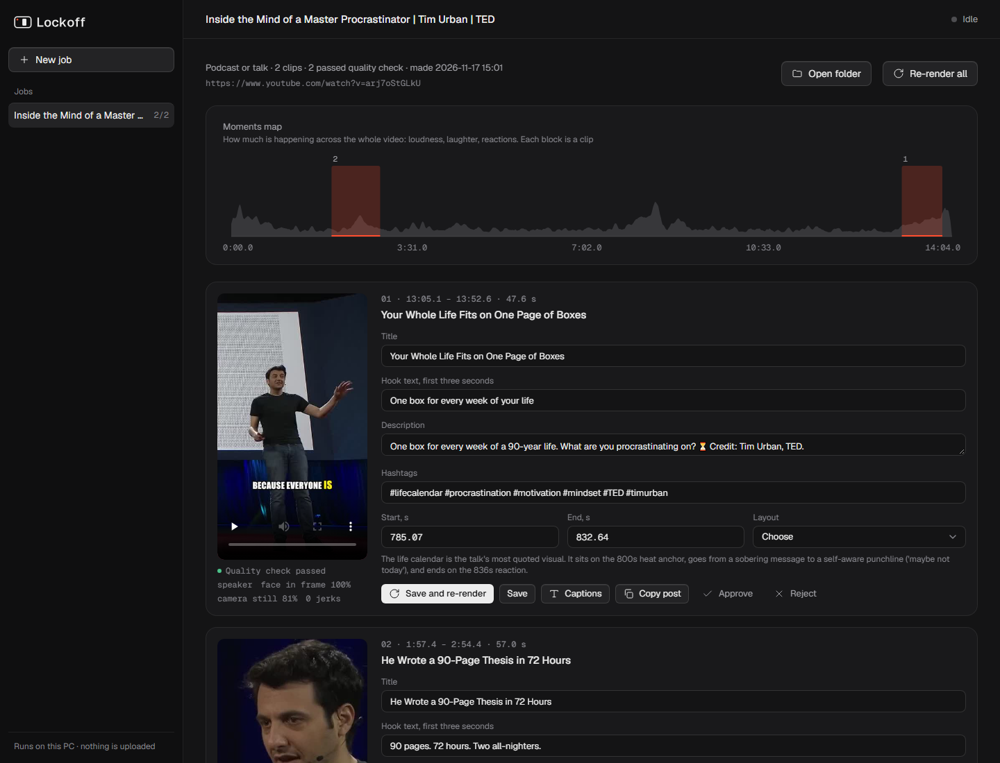
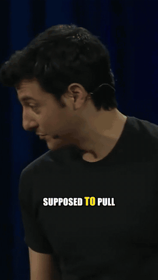
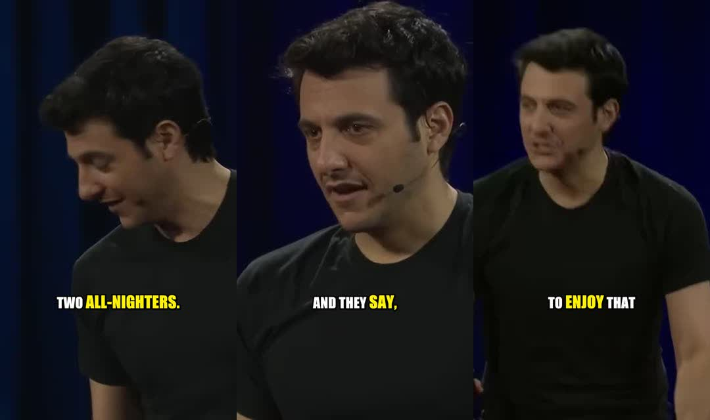
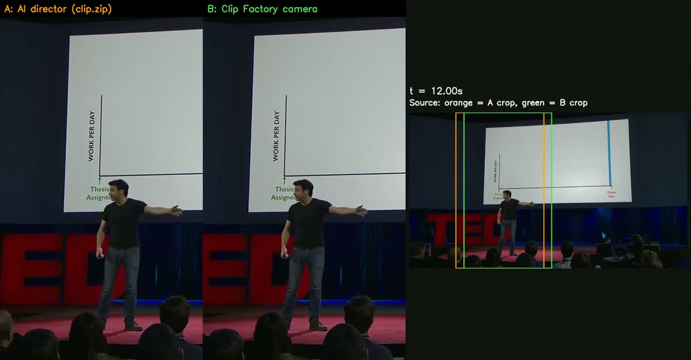
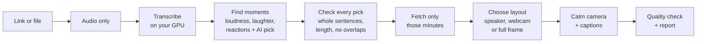
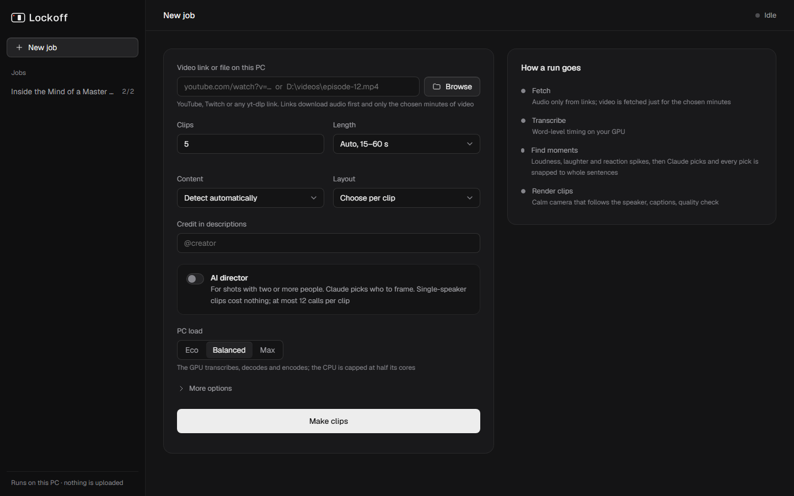

<p align="center">
  <picture>
    <source media="(prefers-color-scheme: dark)" srcset="branding/lockoff-logo-dark.svg">
    
  </picture>
</p>

<h3 align="center">Turn long videos into vertical clips that look hand-edited.<br>On your own PC. Free.</h3>

<p align="center">
  Paste a YouTube or Twitch link, or pick a file. Lockoff finds the best moments, cuts them on whole sentences,<br>
  follows the speaker with a calm camera, adds word-by-word captions and checks every clip before you see it.
</p>

<p align="center">
  <a href="#install">Install</a> ·
  <a href="#how-it-works">How it works</a> ·
  <a href="#the-camera">The camera</a> ·
  <a href="#use-it">Use it</a> ·
  <a href="#faq">FAQ</a>
</p>

<p align="center">
  
</p>

---

## What you get

<table>
<tr>
<td width="270" valign="top"></td>
<td valign="top">

**Clips that are ready to post**
- 1080×1920, 30 fps, loudness at -14 LUFS
- Bold word-by-word captions with the spoken word highlighted
- A hook line on screen for the first three seconds
- A title, description and hashtags for every clip

**Moments worth watching, not random cuts**
- Loudness spikes, laughter, cheering and reaction words are measured across the whole video
- An AI reads the transcript with those signals and picks the moments
- Every pick is snapped to whole sentences and never opens on "so…" or "and that's why…"

**Everything stays on your machine**
- Transcription runs on your GPU, video never leaves your PC
- Links download only the minutes that become clips, never the whole stream

</td>
</tr>
</table>

<p align="center"></p>

## The camera

Most auto-reframe tools chase the face every frame, so the picture twitches. Lockoff plans each shot the way a camera operator would. It is named after the **lock-off**, a shot where the camera is locked still on a tripod.

- **Holds still** until the speaker actually leaves the frame
- **One smooth move** when it has to, easing in and out and starting just before the speaker moves
- **Cuts only where the video already cuts**, never a jump cut inside a shot and never a whip pan
- **Follows whoever is talking**, judged by lip movement, with no flip-flopping between people

<p align="center"></p>

Measured on the same 25-second segment against an AI-director reframer that asks a vision model who to follow:

| | AI-director reframer | **Lockoff** |
|---|---|---|
| Speaker's whole face in frame | 72.6% – 82.8% | **87.2% – 96.9%** |
| Face centre in frame | 92.5% – 96.4% | **100%** |
| Sudden jerks in camera speed | 15 | **0** |
| Camera perfectly still | 57% | **66%** |
| AI calls needed | 9 | **0** |

Ranges are from two independent face detectors. For podcasts with two people on screen, an optional **AI director** can still choose who to frame. It is used only on shots with two or more people, so single-speaker clips cost nothing.

## How it works



| Layout | When | What you see |
|---|---|---|
| Speaker | Talks, podcasts, interviews, IRL | A 9:16 crop that follows whoever is talking |
| Webcam | Gaming streams | The facecam on top, gameplay below |
| Full frame | Slides, wide shots, no clear face | The whole frame over a blurred copy of itself |

Every clip gets a quality check: size, length, audio sync, face in frame and camera smoothness. Anything that fails is flagged in the app.

## Install

Windows 10 or 11. An NVIDIA GPU is recommended, but not required.

1. Install FFmpeg: `winget install Gyan.FFmpeg`
2. Install [Python 3](https://www.python.org/downloads/)
3. Download this repo and double-click **`setup.bat`**. It sets up its own Python 3.12 in the folder and does not touch your system.
4. Double-click **`Start Lockoff.bat`**. The app opens in your browser at `http://127.0.0.1:8765`.

To pick moments with Claude, install [Claude Code](https://claude.com/claude-code) and sign in once. Without it, choose *No AI, loudest moments* and everything runs offline.

## Use it

<p align="center"></p>

**In the app:** paste a link or click Browse, choose how many clips, click **Make clips**. When the job is done, open it to watch each clip. Fix a title, the hook, the in and out points or a misheard caption word, then **Save and re-render**. Approve the keepers and open the folder.

**From the command line:**

```bash
lockoff run "https://www.youtube.com/watch?v=..." --clips 5 --credit @creator
lockoff run "D:\videos\episode-12.mp4" --profile podcast --director on
lockoff watch                # makes clips from every video dropped into Inbox/
lockoff rerender <job> --clip 2
lockoff doctor               # checks your setup
```

| Option | Values | |
|---|---|---|
| `--clips` | 1 – 30 | How many clips |
| `--length` | auto · short · medium · long | 15–60 · 15–30 · 20–45 · 30–75 seconds |
| `--profile` | auto · podcast · stream | What matters most when picking moments |
| `--layout` | auto · speaker · facecam · general | Force a layout |
| `--llm` | claude · claude:opus · ollama:&lt;model&gt; · none | Who picks the moments |
| `--director` | on · off | AI director for multi-person shots |
| `--power` | eco · balanced · max | How hard to work your CPU |
| `--whisper` | auto · small · medium · large-v3 | Auto picks by GPU memory |

## Your PC

| | |
|---|---|
| Balanced, the default | The GPU transcribes, decodes and encodes, and the CPU is capped at half its cores at low priority. Measured on a GTX 1650 and i5-9400F: about 48% CPU while rendering |
| GPU upgrades | Detected on every run. NVIDIA, Intel and AMD encoders are tried in that order, and more GPU memory gets a more accurate transcription model |
| A 14-minute talk | About 5–8 minutes for transcription, picking and two clips on a GTX 1650 |

## FAQ

**Does my video get uploaded anywhere?**
No. Video, audio and transcription stay on your PC. If you use Claude to pick moments, only the transcript text is sent to it.

**What if I don't have Claude?**
Choose *No AI, loudest moments* and Lockoff picks by loudness, laughter and reactions. A local model through Ollama is supported with `--llm ollama:<model>`.

**Can I use it on Mac or Linux?**
Not yet. The pipeline is Python and FFmpeg, so the work is mostly the launchers. Contributions are welcome.

**Can I clip anyone's stream?**
Only clip your own content, or creators who allow it, and credit them with `--credit`. Lockoff never uploads anything for you.

## Limits

- Windows only for now
- The AI director has been tested on talks, not yet on many two-person podcasts
- The demo images come from a TED talk ([Tim Urban](https://www.ted.com/talks/tim_urban_inside_the_mind_of_a_master_procrastinator), TED, CC BY-NC-ND 4.0) and will be replaced with original footage

## Built with

[faster-whisper](https://github.com/SYSTRAN/faster-whisper) · [FFmpeg](https://ffmpeg.org) · [OpenCV](https://opencv.org) and the YuNet face detector · [YAMNet](https://github.com/tensorflow/models/tree/master/research/audioset/yamnet) · [PySceneDetect](https://www.scenedetect.com) · [yt-dlp](https://github.com/yt-dlp/yt-dlp) · [Geist](https://vercel.com/font)

## License

[MIT](LICENSE). Bundled fonts and models keep their own licenses, listed in the license file.
